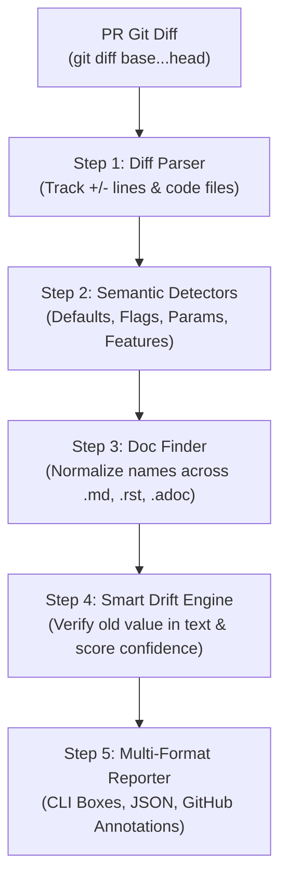

# 🧭 Documentation Drift Detector (DocDrift)

[]()
[]()
[]()

> **Automated Documentation Drift Detection for Pull Requests.**  
> Catches outdated prose, config tables, default values, renamed flags, and removed features *before* they merge into production.

---

## 💥 The Problem

Documentation silently drifts whenever code changes in a Pull Request:
* An engineer updates `DEFAULT_TIMEOUT = 30` to `DEFAULT_TIMEOUT = 60` in `settings.py`.
* The documentation in `docs/config.md` still reads:  
  > *"The default timeout is 30 seconds."*
* Existing validation tools (`python -m doctest`, `mktestdocs`, `Doc Detective`) **only validate executable code blocks**. They **CANNOT** detect whether explanatory prose, config tables, or tutorial instructions still match reality.

**DocDrift** solves this by performing semantic diff analysis on code changes in a PR, locating affected documentation, and isolating the **exact sentence** that has drifted—with actionable fix suggestions.

---

## ⚡ Key Capabilities

1. **Semantic PR Diff Parsing:** Analyzes git diffs (`base...head`) across Python, JavaScript/TypeScript, Go, Rust, Java, YAML, TOML, JSON, and `.env` files.
2. **Four Specialized Semantic Detectors:**
   - 🔢 **Changed Default Values:** Constants (`DEFAULT_TIMEOUT`), dict defaults, function kwargs, YAML/TOML keys, `.env` settings.
   - 🚩 **Renamed Flags & Config Keys:** CLI options (`--old-flag` $\to$ `--new-flag` in argparse, Click, Typer) and renamed configuration keys.
   - ⚙️ **Changed Function Parameters:** Added/removed parameters and modified default arguments via AST analysis.
   - 🗑️ **Removed Features:** Deleted functions or classes verified to no longer exist in the codebase.
3. **Smart Natural Language Normalization:** Bridges code and human writing (`DEFAULT_TIMEOUT` $\equiv$ `default_timeout` $\equiv$ `default timeout` $\equiv$ `default-timeout` $\equiv$ `defaultTimeout`).
4. **False-Alarm Mitigation:** For default value changes, it **only** flags when the **old value** (e.g. `30` or `30s`) actually appears in the documentation sentence.
5. **Exact Sentence Highlighting:** Extracts and pins the precise faulty sentence and table row.
6. **First-Class GitHub Actions Workflow:** Generates inline PR diff annotations (`::error`, `::warning`) and PR Step Summaries.

---

## 📁 Project Structure

```text
doc-drift-detector/
├── drift_detector.py                  # Main CLI entrypoint
├── detectors/
│   ├── __init__.py                    # CodeChange data model & detector exports
│   ├── default_value.py               # Detects changed default values & constants
│   ├── flag_rename.py                 # Detects renamed CLI flags & config keys
│   ├── param_change.py                # Detects changed function signatures & defaults
│   └── feature_remove.py              # Detects deleted functions & classes
├── utils/
│   ├── __init__.py
│   ├── diff_parser.py                 # Unified git diff parser with line tracking
│   ├── doc_finder.py                  # Doc discovery, name normalizer & drift engine
│   └── reporter.py                    # Colored terminal, JSON & GitHub action reporter
├── .github/workflows/
│   └── doc-drift.yml                  # Ready-to-use GitHub Action workflow
├── requirements.txt                   # Dependencies
├── README.md                          # Documentation
└── tests/
    └── test_basic.py                  # Complete test suite
```

---

## 🚀 Quickstart

### 1. Installation

DocDrift is built primarily using Python's standard library for zero-friction setup.

```bash
cd doc-drift-detector
pip install -r requirements.txt
```

### 2. Analyze a Pull Request Diff

```bash
# Compare base branch (main) with current branch (HEAD)
python drift_detector.py --base main --head HEAD

# Analyze an offline diff file
python drift_detector.py --diff-file my_pr.diff

# Output JSON report
python drift_detector.py --base main --head HEAD --json

# Save report to a file
python drift_detector.py --base main --head HEAD --output report.json
```

---

## 📋 CLI Options

| Option | Type | Default | Description |
| :--- | :--- | :--- | :--- |
| `--base` | `str` | `None` | Base branch or commit SHA (e.g., `main`, `origin/main`, `HEAD~1`) |
| `--head` | `str` | `None` | Head branch or commit SHA (e.g., `HEAD`) |
| `--diff-file` | `path` | `None` | Path to pre-generated `.diff` or `.patch` file |
| `--repo-dir` | `path` | `.` | Root directory of the repository to scan |
| `--docs-dir` | `path` | `.` | Directory containing documentation files (`.md`, `.rst`, `.adoc`, `.txt`) |
| `--format` | `choice` | `text` | Output format: `text`, `json`, `github`, or `markdown` |
| `--json` | `flag` | `False` | Shorthand for `--format json` |
| `--output` | `path` | `None` | File path to write the formatted report |
| `--min-confidence` | `choice` | `medium`| Minimum issue confidence to report: `high`, `medium`, or `low` |
| `--fail-on` | `choice` | `high` | Exit with code `1` if drift of this level is found: `high`, `medium`, `any`, `none` |
| `-v`, `--verbose` | `flag` | `False` | Enable step-by-step pipeline logging |

---

## 🔍 How It Works (The 5-Step Pipeline)



### Step 1: Parse PR Diff (`utils/diff_parser.py`)
- Executes `git diff <base>...<head> --unified=0`.
- Isolates code files (`.py`, `.js`, `.ts`, `.go`, `.rs`, `.java`, `.yaml`, `.yml`, `.toml`, `.json`, `.env`, `.cfg`, `.ini`).
- Extracts exact removed (`-`) and added (`+`) lines with source line numbers.

### Step 2: Semantic Code Change Detection (`detectors/`)
- **Default Values (`default_value.py`):** Pairs removed `VAR = OLD` with added `VAR = NEW`.
- **Flag Renames (`flag_rename.py`):** Pairs removed `--old-flag` with added `--new-flag`, or renamed config keys with identical values.
- **Param Changes (`param_change.py`):** Uses Python AST / regex to detect signature modifications and modified default arguments.
- **Feature Removals (`feature_remove.py`):** Detects deleted functions or classes, verifying they don't exist elsewhere in the repo.

### Step 3: Documentation Search (`utils/doc_finder.py`)
- Scans `.md`, `.rst`, `.adoc`, and `.txt` files (excluding `.git`, `node_modules`, `venv`, etc.).
- Normalizes names into searchable variants (`DEFAULT_TIMEOUT` $\to$ `"default timeout"`, `default-timeout`, etc.).
- Extracts the exact sentence using punctuation boundaries and table row delimitation.

### Step 4: Smart Drift Decision Engine
- **DEFAULT_VALUE_CHANGED:** Flags **only** if the old value (e.g. `30` or `30s`) appears in the matched doc sentence. If the identifier is mentioned without the old value, it is skipped to prevent false alarms.
- **FLAG_RENAMED:** Flags if the old flag name appears in documentation.
- **PARAM_CHANGED:** Flags if removed parameter or old default is in documentation.
- **FEATURE_REMOVED:** Flags if documentation references the deleted feature.

#### Confidence Levels
- 🔴 **HIGH (Merge Blocker):** Exact name match + old value confirmed in doc sentence.
- 🟡 **MEDIUM (Warning):** Normalized match or function signature change.
- ⚪ **LOW (Info):** Weak / partial match.

### Step 5: Multi-Channel Reporting (`utils/reporter.py`)
- **Human-Readable CLI:** Rich colored badges, exact file:line references, quotes, and suggested fixes.
- **JSON Schema:** Machine-readable output for dashboards and metrics.
- **GitHub PR Annotations:** Inline warnings directly in the GitHub PR review interface.

---

## 🖥️ Example CLI Output

```text
======================================================================
  DOCUMENTATION DRIFT DETECTOR — PR ANALYSIS
======================================================================
Code Changes Analyzed: 3 | Doc Files Scanned: 4
Drift Issues Found: 2 (2 HIGH, 0 MEDIUM, 0 LOW)
----------------------------------------------------------------------

Issue #1: DEFAULT VALUE DRIFT  [HIGH - MERGE BLOCKER]
  Doc Location  : docs/configuration.md:42
  Wrong Sentence: "The default timeout is 30 seconds before reconnecting."
  Code Culprit  : src/config.py:12 [DEFAULT_TIMEOUT] (30 -> 60)
  Suggested Fix : Update default value from '30' to '60'

Issue #2: FLAG / CONFIG RENAME DRIFT  [HIGH - MERGE BLOCKER]
  Doc Location  : docs/cli_reference.md:88
  Wrong Sentence: "Run `worker --old-flag` to enable legacy processing mode."
  Code Culprit  : src/cli.py:54 [--old-flag] (--old-flag -> --new-flag)
  Suggested Fix : Rename flag/key '--old-flag' to '--new-flag'

======================================================================
 FAILED: 2 high-confidence drift issue(s) require documentation updates.
======================================================================
```

---

## 🤖 GitHub Actions Integration

Add `.github/workflows/doc-drift.yml` to your repository:

```yaml
name: Documentation Drift Detection

on:
  pull_request:
    branches: [ main, master ]

jobs:
  check-drift:
    runs-on: ubuntu-latest
    steps:
      - uses: actions/checkout@v4
        with:
          fetch-depth: 0

      - uses: actions/setup-python@v5
        with:
          python-version: '3.11'

      - name: Run DocDrift
        run: |
          python3 doc-drift-detector/drift_detector.py \
            --base "${{ github.event.pull_request.base.sha }}" \
            --head "${{ github.event.pull_request.head.sha }}" \
            --format github
```

Inline GitHub PR annotations will appear directly on the changed documentation files, blocking merge until documentation is updated!

---

## 🧪 Running Tests

The test suite covers all units, detectors, normalization logic, and end-to-end integration:

```bash
python3 -m pytest tests/test_basic.py -v
```

Output:
```text
tests/test_basic.py::test_diff_parser_filters_code_files PASSED
tests/test_basic.py::test_diff_parser_tracks_lines PASSED
tests/test_basic.py::test_detect_default_value_python_constant PASSED
tests/test_basic.py::test_detect_default_value_yaml_json PASSED
tests/test_basic.py::test_detect_default_value_env PASSED
tests/test_basic.py::test_detect_flag_renames_cli PASSED
tests/test_basic.py::test_detect_flag_renames_config_key PASSED
tests/test_basic.py::test_detect_param_change_added_parameter PASSED
tests/test_basic.py::test_detect_param_change_modified_default PASSED
tests/test_basic.py::test_detect_feature_removal PASSED
tests/test_basic.py::test_name_variants_normalization PASSED
tests/test_basic.py::test_extract_exact_sentence PASSED
tests/test_basic.py::test_drift_default_value_smart_filter PASSED
tests/test_basic.py::test_end_to_end_pipeline PASSED
```

---

## 🏆 Hackathon Highlights

- **Zero-Dependency Core:** Runs everywhere without heavy ML or external network API calls.
- **Precision First:** Smart filtering eliminates false alarms by validating value occurrences in context.
- **Universal Code Support:** Works across Python, JS/TS, Go, Rust, Java, YAML, TOML, JSON, and ENV files.
- **Developer Experience:** Clear, colored terminal UI and automated GitHub Action PR annotations.

